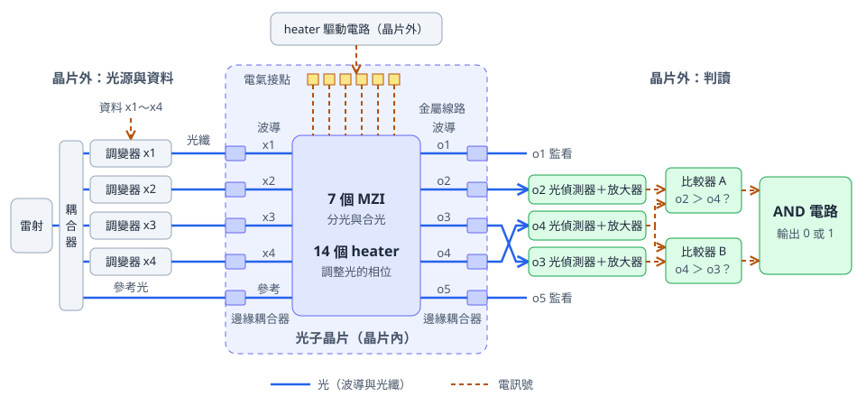
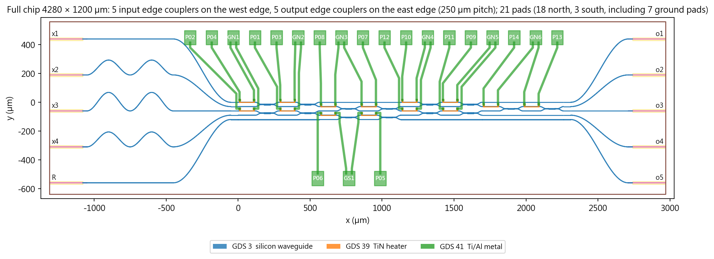

# Programmable Silicon Photonic 4-input LUT Design

This project designs a silicon photonic chip that performs logic operations with light. By tuning 14 heaters (tiny heating elements) on the chip, the same chip can switch to any one of 65,536 logic functions.

The project covers the principle, computer simulation, the chip layout (the actual shapes on the chip) and the check results. The current results come from computer simulation and design checks. The next stage is chip fabrication and measurement.

## Purpose

### Computing with light

The chips in phones and computers compute with electric current. This project explores another approach: computing with light.

Think of light as waves on water. When two waves move in step, they add up to a bigger wave. When two waves move in opposite steps, they cancel each other. This project lets several beams of light meet on the chip and then compares which outputs are brighter. The brightness gives the answer.


1. **Send data (off-chip):** A laser emits light, and a coupler splits it into five paths. Four paths pass through modulators, which turn the four inputs x1–x4 into light signals. The fifth path serves as the reference light. The five beams enter the chip through optical fibers.
2. **Light mixes (on-chip):** The light passes through 7 MZIs. An MZI is a small component that splits light into two paths and then combines them again.
3. **Compare brightness (off-chip):** The chip has five light outputs, o1–o5, and the readout uses o2, o3 and o4. Photodetectors measure the brightness of these three outputs. Comparator A checks whether o2 is brighter than o4, and comparator B checks whether o4 is brighter than o3.
4. **Output the answer (off-chip):** An AND gate combines the results of the two comparators. When both comparators answer "yes", the answer is 1. In every other case, the answer is 0.

The 14 heaters on the chip fine-tune the phase of the light, that is, the timing of each wave. When the timing changes, the way the light mixes changes, and the logic function of the chip changes with it.

### On-chip and off-chip

The complete system consists of the photonic chip and off-chip equipment. This project designs the photonic chip.



The dashed frame is the photonic chip, and everything outside it is off-chip equipment. Solid blue lines carry light, and dashed orange lines carry electrical signals. Light enters the chip on the left and leaves on the right. The heater control signals enter from the top through the electrical pads. o4 feeds both comparators, so the figure draws o4 between o2 and o3.

| Location | Components |
|---|---|
| On the photonic chip | 10 edge couplers (where light enters and leaves), waveguides, 7 MZIs, 14 heaters, metal lines and electrical pads |
| Off-chip | Laser, coupler, data modulators, heater driver, photodetectors, amplifiers, two comparators, AND gate |

In this project, the off-chip equipment is represented by mathematical models and specifications.

### What is a logic operation

A logic operation turns several inputs, each 0 or 1, into one answer that is 0 or 1. For example, AND means "the answer is 1 only when every input is 1." Every computation in a computer is built from operations like this.

### What is a LUT4

LUT stands for look-up table. The 4 means four inputs.

Four inputs have 16 combinations. Assigning an answer to each combination gives an answer table, called a truth table. Each answer can be 0 or 1, so there are 2¹⁶ = 65,536 truth tables in total.

A LUT4 chip works like an answer book whose pages can be swapped. Tuning the 14 heaters is like loading a different answer table.


### Two ways to send data

This project designs two versions. Both use the same optical circuit, and each represents data in its own way.

| Version | Analogy | Data 0 | Data 1 |
|---|---|---|---|
| OOK (on-off keying) | A flashlight switch | Light off | Light on |
| E± | A wave that keeps shining, with the data carried by the wave's direction | Wave starts upward (E+) | Wave starts downward (E−) |

E stands for the light wave, and E+ and E− are the two kinds of light in the E± version. They have the same brightness and a phase difference of 180°, which means the waveform is flipped upside down. The minus sign marks this flip.

Measured alone, E+ and E− have the same brightness. The difference appears when beams meet: where E+ reinforces the reference light, E− cancels it. So the E± version also reads its answer from the brightness after mixing.

### Data inputs and function settings

The chip uses two kinds of input, and each has its own role.

| Item | Meaning | When it changes |
|---|---|---|
| x1–x4 | The data for this calculation | Can change with every calculation |
| 14 heaters | Which logic function the chip performs | Adjusted when switching functions |

The off-chip photodetectors, comparators and AND gate stay fixed. Switching the logic function only requires tuning the 14 heaters.

### Worked example: x1 AND x2

This example sets the OOK chip to compute x1 AND x2: the answer is 1 only when both x1 and x2 are 1.

1. **Set the function:** Tune the 14 heaters to the settings for this function. The values are stored under `AND2` in `design/lut4/s1_handoff/out/phases.json`.
2. **Send data:** In the table below, x3 and x4 are both 0, and x1 and x2 go through the four combinations.
3. **Read the brightness:** Photodetectors measure o2, o4 and o3.
4. **Decide the answer:** Comparator A checks whether o2 is greater than o4, comparator B checks whether o4 is greater than o3, and the AND gate combines the two results.

| x1 | x2 | o2 | o4 | o3 | Comparator A: o2 > o4 | Comparator B: o4 > o3 | Answer |
|---|---|---|---|---|---|---|---|
| 0 | 0 | 1.24 | 1.30 | 2.50 | no | no | 0 |
| 1 | 0 | 1.57 | 2.88 | 1.33 | no | yes | 0 |
| 0 | 1 | 2.77 | 0.76 | 1.91 | yes | no | 0 |
| 1 | 1 | 3.24 | 2.06 | 0.91 | yes | yes | 1 |

The brightness values come from computer simulation, in units of the power of one data beam. Only the last row has both comparators answering "yes", and that matches x1 AND x2 exactly.

The name AND appears twice here. x1 AND x2 is the logic function set by the heaters this time. The AND gate is a fixed part of the receiver that combines the two comparator results.

The command below lists all 16 inputs:

```bash
python example_and.py
```

## Results

The table below shows the design and simulation results of the two versions.

| Item | OOK | E± | Meaning |
|---|---|---|---|
| Achievable truth tables | 65,536 | 65,536 | Every answer table can be built |
| Independent recheck | All 1,048,576 rows correct | All 1,048,576 rows correct | A separate program recomputes every row |
| Smallest margin | 0.0578 | 0.235 | Safety distance of the hardest table |
| Median margin | 0.232 | 0.620 | Safety distance in a typical case |
| Chip size | 4.28 × 1.2 mm | 4.28 × 1.2 mm | About the size of a grain of rice |
| Electrical pads | 21 | 19 | Used to control the heaters |
| Electrical connection check | 14/14 | 14/14 | All 14 heaters connect correctly |
| Optical connection check | 10/10 | 10/10 | All 10 optical ports connect correctly |
| Fault test | 8/8 detected | 8/8 detected | Every deliberately inserted error is caught |

**Margin** is the safety distance in the readout. When two beams are compared, a larger brightness difference gives a more stable readout that tolerates more error. Margin is measured in units of the power of one data beam.

The project also includes a smaller unit called B7. B7 is the basis of the LUT4, and all 80 rows of its 5 logic functions read correctly.

The layout of the OOK chip is shown below. The 5 light inputs are on the left, the 5 light outputs are on the right, and the green lines connect to the electrical pads that control the heaters.



## From idea to chip layout file

Each version went through the five steps below.


## Current stage and next steps

**Completed:** phase calculation and recheck for all 65,536 truth tables, circuit simulation, chip layout, connection checks and the design data packages.

**Next steps:**

1. **Ground lines of the E± version:** In the E± version, several heaters share a ground line, so their currents affect each other. A model estimate shows that with 1 kΩ heaters and per-heater calibration, 4,721 truth tables need further work. The next step is to adjust the ground layout or to adopt a method that calibrates all heaters together. In the OOK version, each ground line runs to its own pad, and the shared resistance in the model is 0.
2. **Formal process sign-off:** Submit the chip layout file to the platform, which runs the full design rule check and sign-off.
3. **Fabrication and measurement:** Fabricate the chip, then verify the model with measured results.
4. **PTF2 analysis:** This analysis explores the upper limit of what a single readout can achieve. Rebuilding some columns of one of its tables gives a different set of numbers. The project keeps the original numbers. The rebuilt results are in `design/ptf2/out/ptf2_table8_fixed.json`, and a summary is in `ACCEPTANCE.md`.

For the item-by-item acceptance status, see [ACCEPTANCE.md](ACCEPTANCE.md) (in Traditional Chinese).

## Check it yourself

The steps below recheck every truth table on your own computer. They need only Python and numpy and finish in a few seconds.

```bash
pip install numpy
python verify_phase_bank.py
```

The program first confirms that the data is complete: each of the 65,536 truth-table IDs appears once, and every table has 14 valid phases. It then recomputes every row with the mathematical model of the optical circuit. The output should be:

```text
LUT4 OOK: checking 65,536 truth tables, 1,048,576 rows
  Data complete: each of the 65,536 IDs appears once, 14 phases per table
  Truth tables read correctly: 65,536
  Rows read incorrectly: 0
  Smallest margin: 0.0578 (truth table 0x7996)
  Median margin: 0.2321
LUT4 E±: checking 65,536 truth tables, 1,048,576 rows
  Data complete: each of the 65,536 IDs appears once, 14 phases per table
  Truth tables read correctly: 65,536
  Rows read incorrectly: 0
  Smallest margin: 0.2350 (truth table 0x967A)
  Median margin: 0.6204
Result: all checks passed
```

The small program below deliberately builds 11 broken data sets, such as repeated truth tables, missing truth tables and malformed phases, and confirms that the verifier catches every one of them:

```bash
python test_verify_phase_bank.py
```

The last line should be `Result: caught 11/11 broken data sets, real data passed`.

## Commands and required files

The table lists the software and files each command needs, along with the result of running it on the public contents of this repository. If this is your first time, start with the first three rows, which need only Python and numpy.

| Command | Software | Files | Result |
|---|---|---|---|
| `python verify_phase_bank.py` | Python, numpy | Included in this repository | Runs to completion; all checks pass |
| `python test_verify_phase_bank.py` | Python, numpy | Included in this repository | Runs to completion; all 11 broken data sets are caught |
| `python example_and.py` | Python, numpy | Included in this repository | Runs to completion; all 16 inputs match |
| `.\lab.cmd design\lut4\s9_system\system.py` | IPKISS Python | Included in this repository | Runs to completion in about two minutes. For E±, change `lut4` to `lut4v2` in the path |
| `python check_delivery.py` | Python, numpy | GDS and `drc_result.json` (kept on the author's computer) | Completes part of the checks; see the note below |
| `.\lab.cmd design\lut4v2\s0_coverage\replay_full.py` | IPKISS Python | `reference/coverage_margins.npy` (kept on the author's computer) | Runs up to the step that reads this file |
| `.\lab.cmd design\lut4v2\build_study.py` | IPKISS Python | `commercial.json` (kept on the author's computer) | Runs up to the step that reads this file |
| `.\lab.cmd tools\build_report.py` | IPKISS Python | `PLAN.md` (kept on the author's computer) | Runs up to the step that reads this file |
| `.\lab.cmd design\lut4v2\s5_chip\chip.py` | IPKISS, CORNERSTONE PDK, KLayout | Platform rule file (kept on the author's computer) | Generates the chip layout file and runs up to the rule check |
| `.\lab.cmd design\lut4v2\s6_verify\verify.py` | IPKISS Python, KLayout | GDS and platform rule file (kept on the author's computer) | Runs up to the step that needs these files |

**`lab.cmd`:** This is a Windows command. Run it from the repository root. It uses the IPKISS Python by default. If Python is installed in another location, set the environment variable `LAB_PYTHON` to its path.

**`check_delivery.py`:** First go into `delivery/`, `delivery_lut4/` or `delivery_lut4v2/`, then run this command. Items such as the truth-table recomputation pass: 112/112 for both LUT4 versions and 80/80 for B7. Items that need the GDS are reported as failed, so the last line reports failed items. This is the expected result for the public contents.

## Folder guide

| Location | Contents |
|---|---|
| `verify_phase_bank.py` | Small program for checking the results yourself |
| `test_verify_phase_bank.py` | Negative test confirming that the verifier catches broken data |
| `example_and.py` | Lists all 16 inputs of the x1 AND x2 example |
| `ACCEPTANCE.md` | Item-by-item acceptance status |
| `design/lut4/` | Programs and results for LUT4 OOK |
| `design/lut4v2/` | Programs and results for LUT4 E± |
| `design/m1_logic/`, `m2_circuit/`, `m3_layout/` | Logic, circuit and layout of B7 |
| `design/paper/` | Programs and results of the timing study |
| `design/ptf2/` | Analysis of the single-readout upper limit |
| `delivery/`, `delivery_lut4/`, `delivery_lut4v2/` | Three complete design data packages |
| `docs/img/` | Figures used on this page |
| `figures/` | All project figures |
| `report/src/` | Source fragments of the teaching material |
| `MANIFEST_SHA256.json` | Hash of every file, for confirming file integrity |

## What this repository includes

This repository includes programs, result data, figures and teaching-material sources. The following files stay on the author's computer:

- The design rule files provided by the platform, plus the rules and check reports derived from them.
- Chip layout files (GDS), which contain the platform's component geometry.
- Logs and screenshots from the commercial tools Virtuoso and Calibre.
- Original teaching materials and comparison data from the reference course.
- Finished web pages (HTML) and working notes from development.

For the software and files each command needs, see [Commands and required files](#commands-and-required-files).

**Language:** This page, its figures and the three small programs in the repository root are in English. The comments in the design programs, the data notes, the labels in `figures/` and `ACCEPTANCE.md` are in Traditional Chinese.

## Glossary

| Term | Meaning |
|---|---|
| Photonic chip (PIC) | A chip that carries and processes signals with light |
| Waveguide | A tiny channel on the chip that guides light, like a wire for light |
| MZI | Mach–Zehnder interferometer: splits light into two paths and combines them again, with an adjustable mixing ratio |
| Phase | The timing of a light wave, which decides whether two beams reinforce or cancel when they meet |
| Heater | A tiny heating element on the chip that fine-tunes the phase of light through temperature |
| Reference light | A fixed beam that provides the basis for comparison |
| Coupler | A component that splits one beam of light into several beams |
| Modulator | A component that writes data into a light signal |
| Edge coupler | A port at the edge of the chip where light enters or leaves |
| E+, E− | The two kinds of light in the E± version, with the same brightness and a phase difference of 180° |
| Photodetector | Converts the brightness of light into an electrical signal |
| Comparator | Decides which of two electrical signals is larger |
| Truth table | A table listing the answer for every input combination |
| Margin | The safety distance in the readout; a larger margin gives a more stable readout |
| Layout | The actual shapes on the chip, which the foundry uses for fabrication |
| GDS | The file format sent to the foundry for chip fabrication |
| DRC | Design rule check: compares the layout shapes with the process rules |
| LVS | Layout versus schematic: confirms that the connections in the layout match the design |
| Sign-off | The platform's confirmation, before fabrication, that the design is ready for the foundry |
