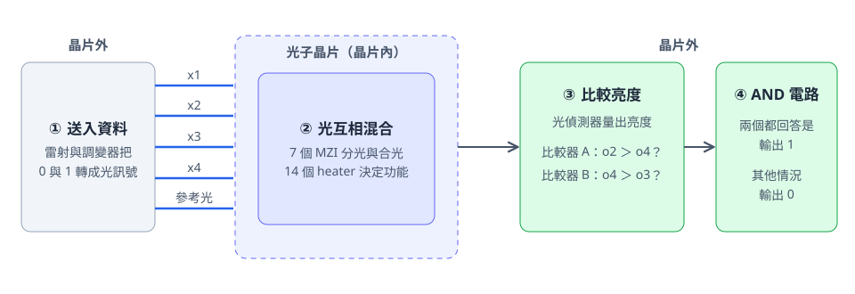
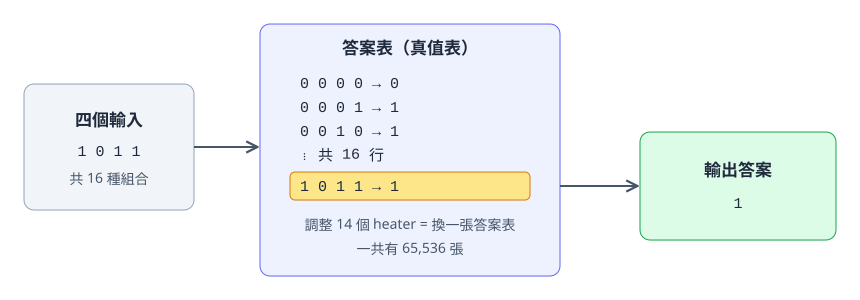
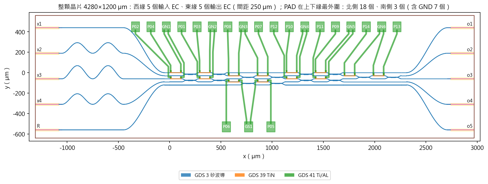
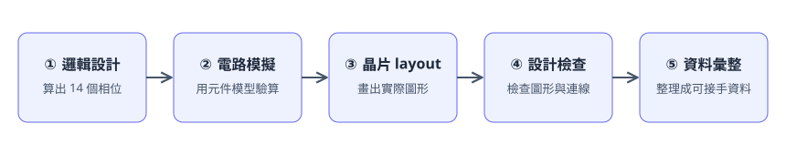

# LUT-PIC-Logic：用光計算的可程式化邏輯晶片

本專案設計一顆用光做邏輯運算的晶片。調整晶片上的 14 個 heater（微型加熱元件），同一顆晶片就能切換成 65,536 種邏輯功能中的任何一種。

專案內容涵蓋原理、電腦模擬、晶片 layout（晶片的實際圖形）與檢查結果。目前的成果來自電腦模擬與設計檢查，下一階段是晶片製造與實際量測。

## 專案目的

### 用光來計算

手機和電腦裡的晶片用電流計算。本專案探索另一種方式：用光計算。

光可以想像成水面上的波。兩道波步調一致時，會合成更大的波。兩道波步調相反時，會互相抵消。本專案讓多道光在晶片上相遇，再比較哪個出口比較亮，由亮度得出答案。



1. **送入資料：** 雷射把四個輸入轉成光訊號，另外加上一道參考光。
2. **光互相混合：** 光進入晶片，經過 7 個 MZI。MZI 是一種把光分開再合起來的小元件。
3. **比較亮度：** 光偵測器量出各個出口的亮度，比較器判斷誰比較亮。
4. **輸出答案：** 比較的結果就是 0 或 1。

晶片上的 14 個 heater 會微調光的步調。步調改變後，光的混合方式跟著改變，晶片的邏輯功能也隨之改變。

### 什麼是邏輯運算

邏輯運算把幾個 0 或 1 的輸入，變成一個 0 或 1 的答案。例如 AND 代表「全部輸入都是 1 時，答案才是 1」。電腦的各種計算都由這類運算組成。

### 什麼是 LUT4

LUT 是 look-up table 的縮寫，意思是查表。4 代表四個輸入。

四個輸入共有 16 種組合。為每一種組合指定一個答案，就得到一張答案表，這張表稱為真值表。每個答案有 0 和 1 兩種選擇，所以真值表一共有 2¹⁶＝65,536 張。

LUT4 晶片就像一本可以換內容的答案本。調整 14 個 heater，就等於換上另一張答案表。



### 兩種送資料的方式

本專案設計了兩個版本。兩版使用相同的光路，各用一種方式表示資料。

| 版本 | 比喻 | 資料 0 | 資料 1 |
|---|---|---|---|
| OOK | 手電筒的開關 | 關燈 | 開燈 |
| E± | 持續發光的波，用波的方向表示資料 | 波朝上起步 | 波朝下起步 |

## 成果

下表是兩個版本的設計與模擬結果。

| 項目 | OOK | E± | 說明 |
|---|---|---|---|
| 可實現的真值表 | 65,536 張 | 65,536 張 | 全部答案表都做得出來 |
| 重新驗算 | 1,048,576 列全部正確 | 1,048,576 列全部正確 | 用另一支程式逐列重算 |
| 最小 margin | 0.0578 | 0.235 | 最難的那張表的安全距離 |
| margin 中位數 | 0.232 | 0.620 | 一般情況的安全距離 |
| 晶片尺寸 | 4.28 × 1.2 mm | 4.28 × 1.2 mm | 約一粒米的大小 |
| 電氣接點 | 21 個 | 19 個 | 用來控制 heater |
| 電氣連線檢查 | 14／14 | 14／14 | 14 個 heater 都接對 |
| 光學連線檢查 | 10／10 | 10／10 | 10 個光接口都接對 |
| 故障測試 | 8／8 檢出 | 8／8 檢出 | 故意放入的錯誤全部被抓到 |

**margin** 是判讀時的安全距離。比較兩道光的亮度時，亮度差距越大，判讀越穩定，也越能承受誤差。margin 的單位是一道資料光的功率。

專案也包含較小的 B7 單元。B7 是 LUT4 的基礎，5 種邏輯共 80 列全部判讀正確。

OOK 版晶片的 layout 如下。左側是 5 個光入口，右側是 5 個光出口，綠色線路連到控制 heater 的電氣接點。



## 從想法到晶片圖檔

每個版本都走過下面五個步驟。



## 目前階段與下一步

**已完成：** 全部 65,536 張真值表的相位計算與驗算、電路模擬、晶片 layout、連線檢查、設計資料彙整。

**下一步：**

1. **E± 版的地線：** E± 版有多個 heater 共用一條地線，電流會互相影響。模型估算顯示，heater 阻值為 1 kΩ 且逐路校正時，有 4,721 張真值表需要進一步處理。下一步是調整地線 layout，或導入同時校正全部 heater 的方法。OOK 版的地線各自連到接點，模型中的共用電阻為 0。
2. **正式製程簽核：** 下一步是把晶片圖檔送交平台，由平台執行完整的設計規則檢查與簽核。
3. **晶片製造與量測：** 製造實際晶片，再用量測結果驗證模型。
4. **PTF2 分析：** 這份分析探討單次判讀能做到的上限。其中一張表的部分欄位，重建後得到另一組數字。專案保留原始數字，重建結果放在 `design/ptf2/out/ptf2_table8_fixed.json`，摘要記錄在 `ACCEPTANCE.md`。

逐項驗收狀態請看 [ACCEPTANCE.md](ACCEPTANCE.md)。

## 親手驗證

下面的步驟可以在自己的電腦重新驗算全部真值表，只需要 Python 與 numpy，約幾秒鐘完成。

```bash
pip install numpy
python verify_phase_bank.py
```

程式會讀取兩份相位資料，用光路的數學模型重新計算每一列。結果應該如下：

```text
LUT4 OOK：檢查 65,536 張真值表、1,048,576 列
  判讀正確的真值表：65,536 張
  判讀錯誤的列數：0
  最小 margin：0.0578（真值表 0x7996）
  margin 中位數：0.2321
LUT4 E±：檢查 65,536 張真值表、1,048,576 列
  判讀正確的真值表：65,536 張
  判讀錯誤的列數：0
  最小 margin：0.2350（真值表 0x967A）
  margin 中位數：0.6204
結果：全部通過
```

## 資料夾導覽

| 位置 | 內容 |
|---|---|
| `verify_phase_bank.py` | 親手驗證用的小程式 |
| `ACCEPTANCE.md` | 逐項驗收狀態 |
| `design/lut4/` | LUT4 OOK 的程式與結果 |
| `design/lut4v2/` | LUT4 E± 的程式與結果 |
| `design/m1_logic/`、`m2_circuit/`、`m3_layout/` | B7 的邏輯、電路與 layout |
| `design/paper/` | 時序研究的程式與結果 |
| `design/ptf2/` | 單次判讀上限的分析 |
| `delivery/`、`delivery_lut4/`、`delivery_lut4v2/` | 三份完整的設計資料 |
| `figures/` | 全部圖片 |
| `report/src/` | 教材的來源片段 |
| `MANIFEST_SHA256.json` | 每個檔案的雜湊值，用來確認檔案完整 |

## 本專案收錄的範圍

本專案收錄程式、結果資料、圖片與教材來源。下列檔案保留在作者本機：

- 平台提供的設計規則檔，以及由它衍生的規則與檢查報告。
- 晶片圖檔（GDS），其中含有平台的元件圖形。
- 商用工具 Virtuoso 與 Calibre 的紀錄與畫面。
- 參考課程的原始教材與核對資料。
- 網頁成品（HTML）與開發過程的工作紀錄。

重新產生晶片圖檔需要 IPKISS、CORNERSTONE PDK 與 KLayout。Windows 上的執行方式是在專案根目錄輸入 `.\lab.cmd <程式路徑>`。

## 名詞表

| 名詞 | 意思 |
|---|---|
| 光子晶片（PIC） | 用光傳遞與處理訊號的晶片 |
| 波導 | 晶片上讓光前進的細小通道，作用像光的電線 |
| MZI | 把光分成兩路再合起來的元件，可以調整光的混合比例 |
| 相位 | 光波的步調，決定兩道光相遇時互相加強或抵消 |
| heater | 晶片上的微型加熱元件，用溫度微調光的相位 |
| 參考光 | 一道固定的光，提供比較的基準 |
| 光偵測器 | 把光的亮度轉成電訊號 |
| 比較器 | 判斷兩個電訊號誰比較大 |
| 真值表 | 列出每一種輸入對應哪個答案的表 |
| margin | 判讀時的安全距離，越大越穩定 |
| layout | 晶片的實際圖形，工廠依這份圖形製造 |
| GDS | 交給工廠製造晶片用的圖檔格式 |
| DRC | 設計規則檢查，用製程規則比對 layout 的圖形 |
| LVS | 確認實際 layout 的連線與設計相符 |
| 簽核 | 製造前由平台確認設計可以送廠 |
